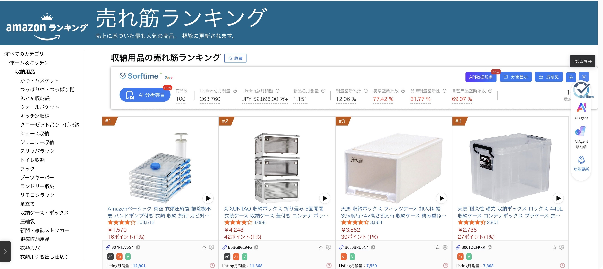

# dsh-tool-codex-computer-use

A DSH Host tool for one-shot desktop or text tasks via a local Codex CLI, not a subagent provider. [中文](README.zh.md).



## Purpose and trade-offs

This tool delegates one-shot tasks from DSH to the local Codex CLI. It supports `mode=desktop` for desktop operations and `mode=text` for text-only delegation. It is not a replacement for Codex and does not support multi-turn conversations.

Each call starts a new `codex exec` process, adding roughly 3–5 seconds of startup overhead compared with working directly in the Codex app. That overhead accounts for about 6% of a single-step task and a smaller share of multi-step tasks; these are approximate figures, not fixed timings.

In return, tasks can be orchestrated within DSH, with a choice of model, reasoning effort and service tier, and run consecutively without supervision. The tool is a poor fit for work that needs ongoing follow-up questions, reuse of context already in Codex, or minimal delay on every call. Unattended execution still carries the risks described under Configuration, including the default `bypass` mode.

Install this package through your DSH profile's npm/package installation flow and load its `cordis.patch.yml` bundle patch. Requires Node >=20 and a signed-in Codex CLI. Desktop tasks additionally require computer-use/browser plugins; on macOS, grant Accessibility and Screen Recording permissions to the relevant Codex/host application. Normal profile installation remains unverified.

Call `computer_use_codex` with `{"task":"Calculate 7×8 and verify by screenshot","cwd":"/path/to/workspace","timeoutSeconds":600}`. The working directory must exist. Each invocation is independent: no follow-up questions or session continuation.

## Supported platforms

| Platform | `mode=text` | `mode=desktop` |
| --- | --- | --- |
| macOS | Supported | Tested: Calculator `7×8=56` |
| Windows | Tested | Tested: Notepad entered `hello`; six screenshots, with the status bar showing 5 characters |
| Linux | Supported | Not guaranteed |

Text mode requires a working local Codex CLI. Windows evidence was supplied by the user on Windows + DSH **0.2.2-rc.2** + Codex CLI **0.167.2**, after temporarily adding the missing status-tool `output` declaration. The fix is now included; these GUI tests were not rerun for this change.

## Relationship with DSH's built-in subagent_codex

- The official `@deepseek-ai/dsh-subagent-codex` is a **subagent provider** registered with `ctx.subagents`. It runs through the Codex app-server and pins its bundled dependency to `@openai/codex@0.153.4`.
- This plugin is a **Host tool** registered with `ctx.tools`. It directly invokes the user's chosen Codex CLI through the configurable `codexBin` path, allowing newer CLI releases and the models available through them to be used.
- The two packages **do not depend on each other and can be installed together**. Use the official provider when you need a subagent tree or session records; use this tool when you need to specify a model or CLI, or delegate a one-shot text-only task with `mode=text`.

Verified with Codex CLI 0.167.2 + DSH 0.2.2-rc.2. This refers to existing validation; it was not rerun for this documentation update.

## Call parameters

| Parameter | Meaning / default |
| --- | --- |
| `task` | Required, non-empty task description. |
| `mode` | `desktop` (default) or `text`. Text tasks do not operate the desktop or create a screenshot directory. |
| `cwd` | Existing working directory; defaults to the Host process directory. |
| `timeoutSeconds` | Integer, 30–3600; inherits plugin config or environment, initially 600. |
| `model` | Model ID; inherits the defaults described below. |
| `reasoningEffort` | Reasoning effort; inherits the defaults described below. |
| `serviceTier` | Service tier; inherits the defaults described below. |

Text example: call `computer_use_codex` with `{"task":"Explain what 7×8 means in one sentence","mode":"text"}`. `mode` is a call argument only; there is no config or environment default for it. Text mode omits desktop/screenshot instructions and directory creation; it does not change `securityMode` or disable Codex plugins.

## Configuration

Explicit `apply(ctx, config)` settings override environment variables. Environment variables must reach the Host process; setting them only in a shell tool may not work. There is no schemastery `Config` export: workspace-linked imports failed, profile resolution is unverified, and no runtime dependency is added.

| Config | Environment | Default |
| --- | --- | --- |
| `codexBin` | `DSH_CODEX_BIN` | executable `codex` on PATH, then `$DSH_PROFILE_DIR/node_modules/@openai/codex/bin/codex.js` |
| `securityMode` | `DSH_CODEX_SECURITY_MODE` | `bypass` |
| `timeoutSeconds` | `DSH_CODEX_TIMEOUT_SECONDS` | `600` (integer, 30–3600) |
| `terminateGraceMs` | `DSH_CODEX_TERMINATE_GRACE_MS` | `5000` milliseconds (integer, 0–30000; `0` skips graceful termination) |
| `screenshotDir` | `DSH_CODEX_SCREENSHOT_DIR` | `<cwd>/.codex-cu/` |
| `model` | `DSH_CODEX_MODEL` | inherit the local Codex configuration |
| `reasoningEffort` | `DSH_CODEX_REASONING_EFFORT` | inherit the local Codex configuration |
| `serviceTier` | `DSH_CODEX_SERVICE_TIER` | inherit the local Codex configuration |

Binary settings must be file paths, not shell commands. Invalid explicit entries fail without fallback; missing entries return readable `ok:false`. JavaScript entries use `DSH_NODE_EXECUTABLE` or the current runtime with `ELECTRON_RUN_AS_NODE=1`. Relative screenshot paths resolve against `cwd`.

`bypass` passes `--dangerously-bypass-approvals-and-sandbox`, disabling approvals and the CLI sandbox, allowing direct desktop/file operations. This remains the compatibility default for GUI use. `workspace-write` instead passes `--sandbox workspace-write`; GUI operations may fail. Results include `securityMode` and `securityNotice`. Neither mode undoes desktop effects or guarantees external GUI plugins are contained by a filesystem sandbox.

## Choosing a model, reasoning effort and service tier

`computer_use_codex` accepts optional call arguments `model`, `reasoningEffort` and `serviceTier`. Set `config.model`, `config.reasoningEffort` and `config.serviceTier` for plugin defaults, or use the environment variables listed above. Each field is resolved independently through three override levels: **call argument > config > environment variable**. If all three are absent, it inherits the local Codex configuration (`~/.codex/config.toml`). Omitting a call argument alone does not bypass config or environment defaults.

Example plugin entry in `cordis.patch.yml`:

```yaml
- insert:
    - id: tool-computer-use-codex
      name: 'dsh-tool-codex-computer-use'
      config:
        model: gpt-6-astra
        reasoningEffort: high
        serviceTier: priority
```

Available models vary with the subscription plan and CLI version. Call `computer_use_codex_status` to inspect the current catalog and use `planType` alongside it when judging model availability. The supplied local snapshot includes `gpt-6.1-sol` and `gpt-6-astra` among 10 models; `gpt-6.1-sol` supports `low` / `medium` / `high` / `xhigh` / `max` / `ultra`. The Fast service tier ID is `priority`; check each model's returned `serviceTiers` before selecting it.

The returned `controls` string lists effective overrides and their sources, separated by spaces. With the config example above and no call overrides, it reads:

```text
model=gpt-6-astra(config) reasoningEffort=high(config) serviceTier=priority(config)
```

`reasoningEffort=high(config)` comes from plugin config; `reasoningEffort=low(environment)` comes from the environment; `reasoningEffort=low` without a suffix comes from a call argument. Fields not listed inherit the local Codex configuration. If no fields are overridden, the entire string is `inherited from Codex config`; it does not report the inherited values themselves.

## Environment inspection

Call `computer_use_codex_status` with `{}` (no parameters). It returns environment JSON directly, without the task result's `ok`/`output` wrapper:

| Field | Meaning |
| --- | --- |
| `codexVersion` | CLI version from `codex doctor --json`, or `unknown`. |
| `latestCodexVersion` | `string` or `null`: latest version from npm; `null` if online checking is disabled or the query fails. |
| `upToDate` | `boolean` or `null`: `true` if the local version is at least the npm latest, `false` if older, or `null` if comparison is unavailable. |
| `desktopAppVersion` | Desktop app version from doctor, or `unknown`. |
| `authMode` | Stored authentication mode from doctor, or `unknown`. |
| `planType` | Local JWT's `chatgpt_plan_type` claim, or `null`; helps interpret the model catalog for the subscription. |
| `subscriptionActiveUntil` | Local JWT's `chatgpt_subscription_active_until` claim, or `null`. |
| `models` | Catalog from `codex debug models`; objects with `slug`, `displayName`, `efforts` (reasoning levels) and `serviceTiers` (tier IDs). Defaults to `[]`. |
| `warnings` | Non-fatal source failures, bundled-catalog notices and upgrade suggestions; `[]` when none occur. |

The third source is `$CODEX_HOME/auth.json` (default `~/.codex/auth.json`). The plugin only decodes the required JWT claims locally; it does not output or transmit tokens. Subscription metadata is a local claim snapshot, not a live entitlement check: use `planType` together with `models`, with Codex validating the final selection.

The three source results are cached for five minutes per resolved CLI path and online-check setting in the current process. A source failure adds a warning while preserving other results. CLI entry resolution must succeed first; its errors are not converted into source warnings. This tool does not run a desktop task or create screenshot directories.

Online checking is enabled by default and accesses `registry.npmjs.org` via `fetch('https://registry.npmjs.org/@openai/codex/latest')`. Successful and failed queries are cached for 6 hours in the current process; each status response adds the version comparison to a copy of the source results. Configure `onlineCheck: false` or set `DSH_CODEX_OFFLINE=1` to disable online checking: no online-check network requests are made, and `latestCodexVersion` / `upToDate` are both `null`. `codex debug models` refreshes online by default; if it fails, the plugin falls back to `codex debug models --bundled` and adds a warning. With online checking disabled, it uses `--bundled` directly and adds an offline-catalog warning. This switch controls inspection, not networking by delegated tasks.

Supplied local snapshot (not rerun for this documentation): `codexVersion: "0.167.2"`, `latestCodexVersion: "0.167.2"`, `upToDate: true`, `desktopAppVersion: "26.1106.51428"`, `authMode: "chatgpt"`, `planType: "prolite"`, `subscriptionActiveUntil: "2026-12-04T12:17:59+00:00"`, 10 models and `warnings: []`. These are observations, not fixed defaults or a universal plan-to-model mapping.

If an older CLI cannot recognize the newer catalog, upgrade the installation actually selected by `codexBin` / `DSH_CODEX_BIN` / PATH / profile. For the profile-local npm installation, the tested-version example is `npm install --prefix ~/.dsh/profiles/desktop @openai/codex@0.167.2`; adjust the prefix to your profile. This is a manual example, not an automatic upgrade. An explicit path or PATH entry can take precedence over that profile installation. Restart the process loading the plugin after upgrading, then call the status tool again.

## CLI version preflight

Before running a task, the plugin probes `codex --version` using the resolved entry and caches the result by entry path within the current process, including probe failures. It compares that version with the npm latest using the shared 6-hour online-query cache described above, rather than a fixed version threshold. When the local CLI is older, `warnings` contains an upgrade suggestion, for example: `旧 CLI（0.153.4），npm 最新 0.167.2，建议升级。` A failed local probe returns `codexVersion: "unknown"`, adds a warning and continues execution. A failed npm query makes comparison unavailable without adding an upgrade warning or blocking execution. The `latestCodexVersion` and `upToDate` fields belong to `computer_use_codex_status`; task results return `codexVersion` and `warnings`. After upgrading the CLI at the same path, restart the process loading the plugin to refresh the local-version cache. See the [architecture guide (Chinese)](docs/ARCHITECTURE.md) for registration, execution flow and the full output contract.

## Results and real evidence

User-supplied Windows results (DSH 0.2.2-rc.2 + Codex CLI 0.167.2, after temporarily fixing status `output`; not rerun here): status returned 10 models, `codexVersion: "0.167.2"` and `planType: "prolite"`; `mode=text` returned `ok:true` in 54.1 s; `mode=desktop` returned `ok:true` in 121.8 s. Notepad contained `hello`, with six screenshots and a status bar showing 5 characters. See the [Windows test guide](docs/WINDOWS-TEST.md).

`computer_use_codex` returns `ok`, `exitCode`, `mode`, `codexVersion`, `warnings`, `durationMs`, `output`, `controls` (effective overrides and sources), security fields, and `logPath` when available. **`ok:true` means successful CLI exit, not achievement of the task objective.** Review screenshots for desktop tasks and the returned text for text tasks. Output is limited to 8000 JavaScript characters. Full logs remain in a private system temporary directory in both modes; final-message files are deleted. Logs/screenshots may contain sensitive data and require manual cleanup. In desktop mode, screenshots are requested as `.jpg` in `<cwd>/.codex-cu/` by default; prompts do not guarantee creation. Text mode does not create this directory.

Supplied local text-mode run (not rerun here): `ok: true`, `durationMs: 34776`, `codexVersion: "0.167.2"`, and `controls: "model=gpt-6.1-sol(config) reasoningEffort=high(config) serviceTier=priority(config)"`.

Previously verified real run, supplied as evidence and not repeated here: `{"ok":true,"exitCode":0,"durationMs":47537,...}`. `<workspace>/.codex-cu/calculator-7x8-56.png` proves Calculator displayed `7×8=56`. The historical `.png` contains JPEG bytes; this change does not rename it. Future prompts request `.jpg`. Evidence is outside the npm package.

## Known limitations

- `subscriptionActiveUntil` is only a snapshot of a JWT claim. A past timestamp does not mean the subscription has expired or lost its benefits.
- Screenshot paths may use forward slashes on Windows; this is a cross-platform display difference. Use the returned absolute path.
- Historical Windows `.codex-cu/*.png` files contain JPEG bytes. The new prompt already requests `.jpg`; existing files are not renamed.

See the [detailed safety and limitations guide (Chinese)](docs/DETAIL.md) for more information.

On task timeout, the plugin requests graceful termination, waits up to `terminateGraceMs`, then escalates to forced termination if the process has not exited. This gives Codex time to clean up computer-use sessions and reduces leftover sessions. `terminateGraceMs` is a plugin setting, not a call argument: config overrides `DSH_CODEX_TERMINATE_GRACE_MS`, with a default of `5000` milliseconds and an integer range of 0–30000. Set it to `0` to send KILL immediately without the graceful step.

Windows first spawns `taskkill /pid PID /T`, then adds `/F` for forced termination. POSIX platforms send SIGTERM to the process group via the negative child PID, then SIGKILL. Failed tree/group termination falls back to `child.kill(signal)` using the signal for that step. Descendants outside the targeted tree or group may remain, and prior GUI effects cannot be undone. Host cancellation through `execute`'s `exec` argument is not implemented because the signal contract is unverified; bounded timeout remains in place.

On macOS, a lingering virtual mouse or screen-sharing indicator is a ChatGPT/Codex desktop app state issue and can remain after the task process exits. For manual cleanup, run:

```sh
pkill -f SkyComputerUseClient; killall SkyComputerUseService 2>/dev/null
```

**Use with care: this affects any ongoing Codex computer-use sessions.** The plugin does not run this command automatically.

## Validation and publication

From this package directory:

```sh
ELECTRON_RUN_AS_NODE=1 "/Applications/DeepSeek Harness.app/Contents/MacOS/DeepSeek Harness" test/smoke.mjs
```

Tests use fake CLIs only: Windows uses `.js` files through the plugin's Node launcher; other platforms retain shell fixtures. Run `node test/smoke.mjs` with Node on Windows. Registration failures, JS fixture commands and three real 30-second timeouts are covered. POSIX tests assert TERM handling, KILL escalation and direct KILL; Windows asserts bounded timeouts and taskkill termination requests without assuming POSIX signal handlers. No desktop operation is performed. Native Windows smoke, real conservative-mode GUI behavior, profile installation and publication were not verified in this change.

The author and MIT copyright holder are `wx5`. Repository metadata uses `https://github.com/wxfiveopps1102/dsh-tool-codex-computer-use`, with `wxfiveopps1102` as the GitHub owner; the repository has not yet been created. Confirm npm name availability and ownership; tag the actual repository `dsh-plugin` for directory submission. The independent unscoped package keeps Host tool semantics separate from subagent providers; maintainers own security review and ongoing maintenance. MIT licensed.
