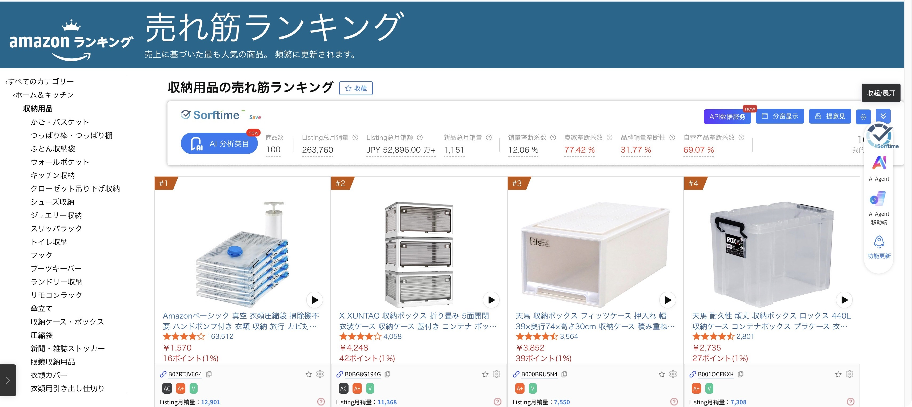

# dsh-tool-codex-computer-use

[English](README.md) | 简体中文

[](LICENSE)
[](https://github.com/deepseek-ai/deepseek-harness)
[](#compatibility)
[](https://github.com/wxfiveopps1102/dsh-tool-codex-computer-use/actions/workflows/validate.yml)

在 DeepSeek Harness（DSH）中将一次性桌面或文本任务交给本机 Codex CLI，并按需选择模型、推理档位与服务层。



*实拍：computer_use_codex 在亚马逊日本站完成类目检索*

## 功能

- **桌面与文本两种模式**：通过 `computer_use_codex` 执行桌面操作或一次性文本任务。
- **模型控制**：按调用或插件默认值选择模型、推理档位与服务层，结果回显生效的覆盖值及来源。
- **环境体检**：`computer_use_codex_status` 返回 CLI 与桌面端版本、模型目录、认证元数据及平台信息。
- **结果可核验**：查看返回文本、截图路径与本地日志；超时后先尝试优雅终止，再强制结束进程。
- **macOS 与 Windows 实测**：已有 macOS 计算器与 Windows 记事本的真实桌面证据，见[兼容性](#compatibility)。
- **轻量 Host bundle**：无运行时依赖，通过 `ctx.tools` 注册工具，调用由 `codexBin` 选择的 CLI。
- **不实现操作原语**：点击、滚动、输入、截图等操作由 Codex 自身的 computer-use 插件完成；本插件只负责委派、参数控制与结果回传。

每个任务都会启动新的 `codex exec` 进程，调用之间独立，不可续接会话或追问。既有测量显示启动开销约 3–5 秒，实际耗时随任务变化。DSH 自带的 `subagent_codex` 是承担另一类职责的 subagent provider，可与本插件共存。

## 与社区同类插件的关系

DSH 社区已存在多个 computer-use 类插件。以下概览基于 **2026-11-12** 的检索结果；这些项目采用了不同的桌面控制方案。

| 项目 | 平台 | 做法 |
| --- | --- | --- |
| [fangchenghao/dsh-computer-use](https://github.com/fangchenghao/dsh-computer-use) | macOS | 可访问性优先（accessibility-first），新鲜观测、过期状态拒绝、作用域权限。 |
| [@wangyong1972/dsh-computer-use-macos](https://www.npmjs.com/package/@wangyong1972/dsh-computer-use-macos) | macOS | 截图 + 鼠标键盘原生控制。 |
| [dsh-plugin-computer-use](https://www.npmjs.com/package/dsh-plugin-computer-use) | Windows / macOS / Linux | Cua Driver 的 Rust 进程内 SDK。 |
| [MoyuDRCC/dsh-computer-use](https://github.com/MoyuDRCC/dsh-computer-use) | Windows | UI Automation 元素寻址。 |
| [gxpppp/dsh-computer-use](https://github.com/gxpppp/dsh-computer-use) | Windows | 复用 Codex 原生 helper。 |
| [JHyugou/dsh-computer-use](https://github.com/JHyugou/dsh-computer-use) | Windows | 提供 25 个工具。 |

**本插件的差异**

| 方面 | 本插件的做法 |
| --- | --- |
| 双模式 | 同一个 `computer_use_codex` 工具通过 `mode=desktop` 做桌面操作，通过 `mode=text` 做纯文本委派。 |
| 自选 CLI 与模型控制 | `codexBin` 可指定任意本机 Codex CLI 安装，不受上述快照中 DSH 内置 **0.153.4** 的限制；通过 `model`、`reasoningEffort`、`serviceTier` 分别配置模型、推理档位与服务层。 |
| 环境体检 | `computer_use_codex_status` 返回模型目录、套餐元数据、CLI 与桌面端版本，以及 CLI 在线版本比对。 |
| 跨平台已验证 | macOS 与 Windows 11 均已实测，见[兼容性](#compatibility)。 |

**不足**

| 不足 | 实际影响 |
| --- | --- |
| 没有可访问性树或元素寻址 | 以坐标与视觉观测为主，控件级精度不如 accessibility-first 的实现。 |
| 依赖本机 Codex CLI | 需要在本机安装并登录 CLI。 |
| 每次调用启动独立进程 | 每次调用有约数秒冷启动开销，既有测量约为 3–5 秒。 |
| 不做权限作用域与审批面板 | 安全边界依赖 `securityMode` 与 Codex 自身的控制。 |

**什么时候选别人：** 需要元素级精度时，可选 [fangchenghao/dsh-computer-use](https://github.com/fangchenghao/dsh-computer-use) 等 accessibility-first 方案；Windows 上也可评估采用 UI Automation 的 [MoyuDRCC/dsh-computer-use](https://github.com/MoyuDRCC/dsh-computer-use)。需要通过进程内 SDK 做跨平台控制、免去独立 Codex CLI 依赖时，可考虑基于 Cua Driver 的 [dsh-plugin-computer-use](https://www.npmjs.com/package/dsh-plugin-computer-use)。

## 环境要求

- **DSH 0.2.2 系列**；既有端到端验收使用 **0.2.2-rc.2**。
- **Node.js >=20**；仓库 CI 使用 Node.js 24。
- 已安装并登录的 **Codex CLI**；既有验收使用 **0.167.2**，插件调用本机安装。
- 桌面任务需要相应的 computer-use/browser 插件和可用的桌面会话。macOS 上须向相关 Codex/宿主应用授予**辅助功能、屏幕录制**权限。
- `cwd` 指向已存在的工作目录。已测环境与待验证项见[兼容性](#compatibility)。

## 安装

仓库根目录即为可安装的 DSH bundle，`package.json` 指向 `cordis.patch.yml`。请选择实际使用的 DSH profile；若不是 `desktop`，请替换以下命令中的名称。干净 profile 安装尚未验证，既有验收使用本地链接的 bundle。

### 从 Git 仓库安装

当 `dsh` 已在 PATH 中时：

```sh
dsh plugin --profile desktop add git+https://github.com/wxfiveopps1102/dsh-tool-codex-computer-use.git
```

安装后在 DSH **插件**页启用 bundle。替换已安装的版本后，重启 Host 进程以加载新模块。

### 从 DSH 插件页安装

打开**插件 → 添加插件**（Plugins → Add plugin），输入以下 Git 安装目标，完成安装并启用 bundle：

```text
git+https://github.com/wxfiveopps1102/dsh-tool-codex-computer-use.git
```

仓库：[wxfiveopps1102/dsh-tool-codex-computer-use](https://github.com/wxfiveopps1102/dsh-tool-codex-computer-use)。此方式不要求社区市场收录；市场收录仍在计划中。

### 按 npm 包名安装（推荐）

已发布到 npm：`dsh-tool-codex-computer-use@0.1.0`。

```sh
dsh plugin --profile desktop add dsh-tool-codex-computer-use
```

也可先用 `npm view dsh-tool-codex-computer-use version` 确认版本。发布记录见[发布记录](RELEASE.md)。

## 使用

启用插件后，在 DSH 中调用工具。以下 JSON 是工具参数，不是 shell 命令。

### 桌面任务 — `mode=desktop`

调用 `computer_use_codex` 计算数值并请求截图：

```json
{
  "task": "打开计算器，计算 7 × 8，并截图核验结果。",
  "mode": "desktop",
  "cwd": "/absolute/path/to/workspace",
  "timeoutSeconds": 600
}
```

将 `cwd` 替换为已存在的目录；Windows 可使用 `C:/path/to/workspace`。桌面模式为默认值，截图默认请求以 `.jpg` 保存到 `<cwd>/.codex-cu/`，也可另行配置；提示词不保证截图一定生成。

### 文本任务 — `mode=text`

调用 `computer_use_codex` 完成一次性解释：

```json
{
  "task": "用一句话解释 7 × 8 的含义。",
  "mode": "text",
  "timeoutSeconds": 600
}
```

文本模式省略桌面/截图指令及截图目录创建，保留原安全模式，也不禁用 Codex 插件。`mode` 仅为调用参数，没有对应的 config 或环境变量默认值。

### 调用参数

| 参数 | 含义 / 默认值 |
| --- | --- |
| `task` | 必填，非空任务描述。 |
| `mode` | `desktop`（默认）或 `text`。 |
| `verify` | 字符串：`strict`（默认）、`final` 或 `none`。`strict` 每步操作后用截图验证；`final` 仅在结束时截图确认一次。两者均先核对页面/窗口/类目与任务一致，不符即停并报告。`none` 不要求截图，适合纯文本或信任场景。结果对象回显 `verify` 生效值。 |
| `ephemeral` | 布尔值，默认 `false`；为 `true` 时给 `codex exec` 添加 `--ephemeral`，不将会话文件写入磁盘，减少残留，不改变输出。 |
| `cwd` | 已存在的工作目录；默认 Host 进程当前目录。 |
| `timeoutSeconds` | 整数 30–3600；调用参数 > config > 环境变量 > `600`。 |
| `model` | 模型 ID；继承规则见[配置](#配置)。 |
| `reasoningEffort` | 推理档位；与 `model` 使用相同优先级。 |
| `serviceTier` | 服务层；与 `model` 使用相同优先级。 |

`mode=text` 时，`verify` 固定为 `none`。

### 环境体检

以 `{}` 调用 `computer_use_codex_status`。它直接返回环境 JSON，不套用任务结果的 `ok`/`output` 包装，不运行桌面任务，也不创建截图目录。

| 字段 | 含义 |
| --- | --- |
| `platform`、`platformLabel`、`osVersion` | 平台标识、可读平台名与系统版本。 |
| `codexVersion` | `codex doctor --json` 返回的 CLI 版本，无法取得时为 `unknown`。 |
| `latestCodexVersion` | npm 最新版本；关闭检查或查询失败时为 `null`。 |
| `upToDate` | 本地版本不低于 npm 最新时为 `true`，低于时为 `false`，无法比较时为 `null`。 |
| `desktopAppVersion`、`authMode` | doctor 返回的桌面端版本与已保存认证方式，无法取得时为 `unknown`。 |
| `planType` | 本地 JWT 的 `chatgpt_plan_type` 声明，缺失为 `null`。 |
| `subscriptionActiveUntil` | 本地 JWT 的 `chatgpt_subscription_active_until` 声明，缺失为 `null`；不是实时权益查询。 |
| `models` | 模型目录对象数组，每项含 `slug`、`displayName`、`efforts` 与 `serviceTiers`；默认 `[]`。 |
| `warnings` | 数据来源失败、使用离线模型目录或建议升级时的非阻断告警；无告警为 `[]`。 |

数据来自 `codex debug models`、`codex doctor --json` 与 `$CODEX_HOME/auth.json`（默认 `~/.codex/auth.json`）。来源结果在当前进程内按解析后的 CLI 路径及在线检查开关缓存 5 分钟。来源失败仅增加 warning，保留其他结果；CLI 入口解析须先成功。选择模型时结合 `planType` 与 `models` 判断，最终由 Codex 校验。

### 任务返回

`computer_use_codex` 返回 `ok`、`exitCode`、`mode`、`codexVersion`、`warnings`、`durationMs`、`output`、`controls`、`securityMode`、`securityNotice`，日志创建成功时附 `logPath`。**`ok:true` 仅表示 CLI 正常退出，不等于任务目标达成。** 桌面任务结合截图复核，文本任务核对返回文本。

输出最多 8000 个 JavaScript 字符。两种模式的完整日志均保存在私有系统临时目录，最终消息文件自动删除。保存与权限边界见[安全](#安全)，完整输出契约见[架构说明](docs/ARCHITECTURE.md)。

## 配置

`model`、`reasoningEffort`、`serviceTier` 各自独立按以下顺序解析：**调用参数 > 插件 config > 环境变量 > Codex 本地配置**（`~/.codex/config.toml`）。仅省略调用参数，仍会使用 config 或环境变量默认值。`timeoutSeconds` 使用相同的前三层优先级，最后回退到 `600`。

其他设置以 `apply(ctx, config)` 显式值优先于环境变量默认值。环境变量须传入 Host 进程，仅设置 shell 工具环境可能无效。在线检查开关是例外：任一关闭条件均生效，详见下文。

| 配置 | 环境变量 | 默认值 |
| --- | --- | --- |
| `codexBin` | `DSH_CODEX_BIN` | PATH 可执行 `codex`，然后 `$DSH_PROFILE_DIR/node_modules/@openai/codex/bin/codex.js` |
| `securityMode` | `DSH_CODEX_SECURITY_MODE` | `bypass` |
| `timeoutSeconds` | `DSH_CODEX_TIMEOUT_SECONDS` | `600`，整数 30–3600 |
| `terminateGraceMs` | `DSH_CODEX_TERMINATE_GRACE_MS` | `5000` 毫秒，整数 0–30000；`0` 跳过优雅终止 |
| `screenshotDir` | `DSH_CODEX_SCREENSHOT_DIR` | `<cwd>/.codex-cu/` |
| `model` | `DSH_CODEX_MODEL` | 继承 Codex 本地配置 |
| `reasoningEffort` | `DSH_CODEX_REASONING_EFFORT` | 继承 Codex 本地配置 |
| `serviceTier` | `DSH_CODEX_SERVICE_TIER` | 继承 Codex 本地配置 |
| `onlineCheck` | `DSH_CODEX_OFFLINE` | 默认开启；config 为 `false` 或环境变量为 `1` 时关闭体检的在线检查 |

CLI 入口顺序为**配置 → 环境变量 → PATH → profile**。显式入口必须是文件路径，不能是 shell 命令；无效时直接失败，不回退其他入口。任务调用会将入口解析失败报告为可读的 `ok:false` 结果。`.js` 入口使用 `DSH_NODE_EXECUTABLE` 或当前运行时，并设置 `ELECTRON_RUN_AS_NODE=1`。相对截图目录基于 `cwd`。

不导出 schemastery `Config`，也不承诺自动配置界面：workspace 链接导入已失败，profile 解析尚未确认，插件无运行时依赖。

### 模型 × 推理档位矩阵（快照，2026-11-12）

以下为用户提供的 2026-11-12 实时目录快照，本次文档更新未重新拉取。

| 模型 | 支持的档位 |
| --- | --- |
| `gpt-6.1-sol` | `low` / `medium` / `high` / `xhigh` / `max` / **`ultra`** |
| `gpt-6-astra` | `low` / `medium` / `high` / `xhigh` / `max` / **`ultra`** |
| `gpt-6.1-terra` | `low` / `medium` / `high` / `xhigh` / `max` / **`ultra`** |
| `gpt-6-sol` | `low` / `medium` / `high` / `xhigh` / `max` / **`ultra`** |
| `gpt-5.6-sol` | `low` / `medium` / `high` / `xhigh` / `max` / **`ultra`** |
| `gpt-5.6-terra` | `low` / `medium` / `high` / `xhigh` / `max` / **`ultra`** |
| `gpt-reserve` | `low` / `medium` / `high` / `xhigh` / **`max`** |
| `gpt-6-luna` | `low` / `medium` / `high` / `xhigh` / **`max`** |
| `gpt-5.6-luna` | `low` / `medium` / `high` / `xhigh` / **`max`** |
| `codex-auto-review` | `low` / `medium` / `high` / `xhigh` / **`max`** |

`ultra` = `max` 推理 + 自动任务委派，会产生额外子任务与 token 成本。推理档位由 Codex 侧校验，非法值会返回 HTTP 400。实际可用性随套餐与 CLI 版本变化，以 `computer_use_codex_status` 返回的 `models[].efforts` 为准。

### 模型与服务层默认值

`cordis.patch.yml` 中的插件配置示例：

```yaml
- insert:
    - id: tool-computer-use-codex
      name: 'dsh-tool-codex-computer-use'
      config:
        model: gpt-6-astra
        reasoningEffort: high
        serviceTier: priority
```

Fast 服务层 ID 为 `priority`，选择前应检查对应模型返回的 `serviceTiers`。也可通过 `DSH_CODEX_MODEL`、`DSH_CODEX_REASONING_EFFORT`、`DSH_CODEX_SERVICE_TIER` 设置默认值。

返回的 `controls` 字符串以空格分隔，回显生效的覆盖值及来源。使用上面的配置且无调用参数覆盖时为：

```text
model=gpt-6-astra(config) reasoningEffort=high(config) serviceTier=priority(config)
```

`reasoningEffort=high(config)` 表示来自插件配置；`reasoningEffort=low(environment)` 表示来自环境变量；无后缀的 `reasoningEffort=low` 表示来自调用参数。未列出的字段继承 Codex 本地配置；三个字段均无覆盖时，整个字符串为 `inherited from Codex config`，不会展开继承到的具体值。

### 在线检查与缓存

在线检查默认开启。插件查询 `https://registry.npmjs.org/@openai/codex/latest`，成功和失败结果均在当前进程内缓存 6 小时，由任务与体检工具共享。每次体检返回时，将版本比对结果补入来源缓存结果的副本。

设置 `onlineCheck: false` 或 `DSH_CODEX_OFFLINE=1` 可关闭这些在线检查，此时 `latestCodexVersion`、`upToDate` 均为 `null`。模型目录通常通过 `codex debug models` 在线刷新，失败时回退 `codex debug models --bundled` 并告警；关闭在线检查后直接使用 `--bundled`，并提示使用离线目录。这些开关控制体检，不限制委派任务自身联网。

## 工作原理

```text
DSH → ctx.tools → computer_use_codex → 本机 codex exec → 结果 + 本地证据
```

1. bundle patch 加载 `index.js`，注册 `computer_use_codex` 与 `computer_use_codex_status` 两个 Host 工具。
2. 任务调用校验参数、解析配置，并定位所选 CLI。
3. 前置体检执行 `codex --version`，与缓存的 npm 最新版本比较。版本探测结果（包括失败）按入口路径在当前进程内缓存；探测失败返回 `unknown` 并告警，npm 查询失败则无法比较，两者均不阻断执行。
4. 新的 `codex exec` 进程按选定模型控制项与安全参数运行；桌面模式附加桌面/截图指令，文本模式省略这些指令。
5. 插件收集最终消息、执行状态与日志路径。超时先尝试优雅终止，经过 `terminateGraceMs` 后仍未退出则强制终止。

技术细节见[架构说明](docs/ARCHITECTURE.md)、[项目概览](docs/OVERVIEW.md)与[优化记录](docs/OPTIMIZATION.md)。

## 安全

**`securityMode` 默认是 `bypass`。** 它传入 `--dangerously-bypass-approvals-and-sandbox`，关闭 CLI 审批和沙箱，任务可以影响本机桌面与文件。仅在可信任务与环境中使用。`workspace-write` 传入 `--sandbox workspace-write`；该模式下的真实 GUI 行为尚未验证，操作可能失败。结果包含 `securityMode` 与 `securityNotice`。

文本模式保留相同的安全设置与可用插件。文件沙箱不保证约束外部 GUI 插件；超时无法撤销已发生的桌面影响，目标进程树或组之外的后代可能继续运行。由于信号契约尚未确认，暂未接入 `execute` 的 `exec` 取消信号，已实现有界超时。

日志和截图可能包含敏感信息，需要手动清理。体检工具只在本地解码所需 JWT 声明，不输出或外发 token。套餐元数据是本地声明快照，不是实时权益查询；时间戳已过期本身不代表权益终止。委派的 Codex 任务使用现有认证、插件与网络权限，更多说明见[详细安全文档](docs/DETAIL.md)。

<a id="compatibility"></a>

## 兼容性

| 平台 | `mode=text` | `mode=desktop` | 已记录环境 / 证据 |
| --- | --- | --- | --- |
| macOS | 已实测 | 已实测 | DSH 0.2.2-rc.2 + Codex CLI 0.167.2；计算器 `3×9=27`，另有早期 `7×8=56` 证据。 |
| Windows | 已实测 | 已实测 | Windows 11 Pro + DSH 0.2.2-rc.2 + Codex CLI 0.167.2；记事本输入 `hello`，3 张截图，状态栏显示「5 个字符」。 |
| Linux | 未验证 | 未验证，不宣称桌面支持 | 需要单独验证；Ubuntu CI 仅检查语法、清单与打包。 |

既有跨平台验收日期为 **2026-11-12**，本次文档更新未重跑桌面测试。macOS 的具体系统版本未记录。Windows 使用 DSH Desktop 的 `desktop` profile、Node v24.14.0、npm 11.9.0，ChatGPT 登录（`planType: prolite`）。两平台的 smoke、体检、文本与桌面四层检查均通过；体检返回 10 个模型，`warnings: []`。

Windows 结果对应 commit `e99d5a4`：文本任务耗时 52.3 秒，桌面任务耗时 100.5 秒。手动重启 DSH 后两个工具首次调用即成功，无 `must declare output` 告警，`application: applied`、`warnings: []`。完整证据见[跨平台发布记录](RELEASE.md#跨平台验收记录)；[Windows 测试指南](docs/WINDOWS-TEST.md)保留了较早一轮临时修复测试的记录。

待验证项包括 Linux 桌面、`workspace-write` 下的真实 GUI、干净 profile 安装及 npm 安装/发布。模型矩阵是带日期的快照，可用性取决于所选 CLI 与账号。

## 开发

### 仓库结构

```text
.
├── .github/workflows/validate.yml  # 语法、清单与打包检查
├── .gitignore
├── index.js                        # Host 工具与 CLI 执行
├── cordis.patch.yml                # DSH bundle 加载补丁
├── package.json                    # 包元数据与 dsh.bundle
├── icon.svg
├── locale/
│   ├── en.json
│   └── zh.json
├── docs/
│   ├── ARCHITECTURE.md
│   ├── DETAIL.md
│   ├── OPTIMIZATION.md
│   ├── OVERVIEW.md
│   ├── PUBLISHING.md
│   ├── WINDOWS-TEST.md
│   └── assets/amazon-ranking.jpg   # 已打码预览图
├── test/smoke.mjs                   # 假 CLI smoke 测试
├── README.md
├── README.zh.md
├── RELEASE.md                      # 验收与发布记录
└── LICENSE
```

在仓库根目录使用 Node.js 24 与 npm 执行：

```sh
node --check index.js
node --input-type=module -e 'import fs from "node:fs"; import assert from "node:assert/strict"; const pkg = JSON.parse(fs.readFileSync("package.json", "utf8")); assert.equal(pkg.dsh?.bundle?.patch, "./cordis.patch.yml"); assert.ok(fs.statSync(pkg.dsh.bundle.patch).isFile());'
npm pack --dry-run
```

[GitHub Actions](https://github.com/wxfiveopps1102/dsh-tool-codex-computer-use/actions/workflows/validate.yml) 在 push 与 pull request 时使用 Ubuntu 和 Node.js 24 运行以上检查；工作流不执行桌面任务，也不发布包。

修改运行时逻辑时，单独执行已有 smoke 测试：

```sh
node test/smoke.mjs
```

macOS 也可使用 DSH 自带运行时：

```sh
ELECTRON_RUN_AS_NODE=1 "/Applications/DeepSeek Harness.app/Contents/MacOS/DeepSeek Harness" test/smoke.mjs
```

smoke 测试使用假 CLI，不操作桌面。Windows 使用经 Node 启动的 `.js` 测试替身，其他平台使用 shell 测试替身。覆盖注册失败保护、CLI 命令与三类真实 30 秒超时：POSIX 验证 TERM 处理及 KILL 升级，Windows 验证有界超时与 `taskkill` 请求。这些测试不证明真实桌面兼容性。

## 故障排查

| 现象 | 检查项 |
| --- | --- |
| 工具未出现 | 确认 bundle 安装并启用于正确的 profile；替换包后重启 Host。 |
| 找不到 Codex 入口 | 将 `codexBin` 或 `DSH_CODEX_BIN` 设为有效文件路径；显式入口无效时不会回退。Windows 上检查实际可执行文件或 `codex.js` 路径。 |
| 模型或推理档位被拒绝 | 查看 `computer_use_codex_status.models` 中的 `efforts`、`serviceTiers`，使用所选 CLI 与账号可用的值。 |
| CLI 版本或模型目录仍旧 | 升级由配置 / 环境变量 / PATH / profile 实际选中的安装，再重启 Host 清除进程内缓存。 |
| 无法操作桌面 | 检查登录状态、所需插件、桌面权限与 `securityMode`；`workspace-write` 的 GUI 行为尚未验证。 |
| `ok:true`，但结果错误或没有截图 | 核验返回文本和实际截图；CLI 正常退出本身不证明任务完成。 |
| 任务超时或会话残留 | 查看 `logPath`、`timeoutSeconds` 与 `terminateGraceMs`；已发生的桌面影响及脱离进程树的后代可能保留。 |
| npm 找不到包 | npm 发布仍在计划中，请使用 Git 仓库安装。 |

profile 内 CLI 安装的已记录版本升级示例为 `npm install --prefix ~/.dsh/profiles/desktop @openai/codex@0.167.2`，请调整 profile 路径。这是手动操作示例，不会自动升级，也不表示该版本是最新版。显式 CLI 路径或 PATH 入口可能优先于该安装。

超时处理在 Windows 上先请求 `taskkill /pid PID /T`，强制终止时追加 `/F`；POSIX 先向子进程组发送 SIGTERM，再发送 SIGKILL。进程树/组终止失败时回退到 `child.kill(signal)`。`terminateGraceMs` 是插件配置，不是调用参数；设为 `0` 时跳过优雅终止。

Windows 截图路径可能使用正斜杠，请以返回的绝对路径为准。历史 `.png` 截图可能包含 JPEG 字节，当前提示词要求 `.jpg`，不会重命名旧文件。macOS 上的虚拟鼠标或共享指示器可能在任务进程退出后残留，可手动清理：

```sh
pkill -f SkyComputerUseClient
killall SkyComputerUseService 2>/dev/null
```

**这些命令会影响正在进行的 Codex computer-use 会话。** 插件不会自动执行。

## 参与贡献

欢迎提交 [Issue](https://github.com/wxfiveopps1102/dsh-tool-codex-computer-use/issues) 或 Pull Request。请提供系统、DSH 与 Codex CLI 版本、任务模式、预期结果和已脱敏的诊断输出。保持 `README.md` 与 `README.zh.md` 对应，运行开发检查，并区分假 CLI 测试与真实桌面证据。不要提交认证文件、token、私密日志或未打码截图。

验收历史与尚待完成的发布工作见 [RELEASE.md](RELEASE.md)。

## 许可证

[MIT](LICENSE) © 2026 wx5。
